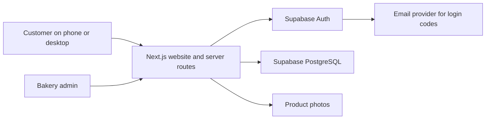

# Proposed architecture and database

Status: architecture design only; no migrations or new workflow have been implemented. File cleanup and removal of deferred legacy features are recorded in [the cleanup record](06-cleanup-record.md).

## Minimal architecture

Reuse `apps/web` as one responsive Next.js/TypeScript application with Tailwind CSS. The target includes both the customer storefront and a protected `/admin` section; secure admin routing is not implemented yet. Native app development is deferred and its files have been removed.

- Supabase remains the database and authentication provider; no backend provider migration is proposed.
- Require customer login; propose email OTP using the existing flow. Phone-only login is an open decision because SMS delivery adds cost and setup.
- For local review, run Next.js locally with a separate local Supabase stack and local email capture. Docker availability is a setup prerequisite to check, not an assumption. If unavailable, agree an isolated test project before creating one; never use real customer data for tests.
- API routes validate input and verified sessions. A single PostgreSQL function handles each order transaction; separate HTTP writes do not form a transaction.
- Reuse bundled images initially; add admin-only Supabase Storage upload after the basic workflow if needed.
- Choose hosting after a local compatibility check and review. Vercel is the more direct Next.js option; Cloudflare Workers is the lower subscription-cost candidate but requires runtime/build compatibility verification.
- Refresh the admin dashboard on demand or with modest polling. Database correctness does not depend on live updates or a displayed availability number.

## Data model

Use UUID primary keys, foreign keys, UTC `timestamptz` values, nonnegative integer paise amounts, and positive integer quantities. Currency is INR. Prices and operating limits are data, never application constants.

| Table | Main fields and rules |
| --- | --- |
| `products` | `id`, `name`, `description`, `image_path`, `base_price_paise`, `active`, timestamps. Archive rather than delete purchased products. |
| `baking_rules` | `id`, weekday, local cut-off time, cut-off days before bake date, enabled. No seeded real business defaults. Used only to generate dated schedules. |
| `baking_days` | `id`, unique `bake_date`, `order_cutoff_at`, status (`draft/open/closed/in_production/completed`), optional rule reference, notes. Explicit dated records are authoritative. Cut-off instant must precede the bake date's agreed fulfilment window. |
| `baking_day_products` | `id`, `baking_day_id`, `product_id`, `capacity`, `allocated_quantity`, `unit_price_paise`, enabled. Unique day/product; check `0 <= allocated_quantity <= capacity`. Snapshot base price when admin prepares the offering, then make price changes explicit. |
| `delivery_areas` | `id`, area name, configurable postcode coverage, enabled, notes. No guessed Mumbai service radius. Courier prices are not required here because each order is quoted separately. |
| `orders` | `id`, human order reference, authenticated `customer_id`, `baking_day_id`, source (`website/phone/social/admin`), customer name/phone/email snapshot, delivery address and area snapshot/reference, fulfilment method, order status, bread subtotal, payment status, delivery quote status/amount, courier name/reference/cost, timestamps. Website orders require customer ID; admin-entered external orders may leave it null with a recorded staff actor. |
| `order_items` | `id`, `order_id`, `baking_day_product_id`, product-name snapshot, unit-price snapshot, quantity, line total, `capacity_released_at` nullable. Positive integer quantities; unique offering per order. Snapshots preserve order history after catalog edits. |
| `admin_memberships` | `user_id` references Supabase Auth, enabled, created_at. Manage only through a trusted owner process. Customers cannot insert/update this table or a role column. |
| `order_requests` | `customer_id` or trusted staff actor, random request key, canonical payload hash, resulting order ID. Unique actor/key; supports safe retries and prevents duplicate capacity reservations. No public lookup by key. |
| `audit_events` | actor, action, entity/order ID, restricted change details, timestamp. Record order transitions, quotes, payment-status changes, and capacity edits. Avoid duplicating full addresses in logs. |

Supabase owns `auth.users`; do not build a second password system. Customer profile/address-book tables are optional later; order snapshots are sufficient initially. Production reports are queries/views over orders and items, not a second inventory database. Weekly rule editing may follow the dated-day prototype; changing a rule must not silently rewrite already opened baking days.

## Capacity reservation transaction

Proposed database operation: `place_order`. Database implementation and tests belong to M2.

1. Server verifies the customer session, takes the identity from that session, and validates delivery/contact inputs. Never trust a customer ID, prices, totals, or payment status supplied by the browser.
2. Start one database transaction. Serialize the actor/request key and check idempotency first. A retry of the same successful payload returns the original order even if the cut-off has since passed; a different payload with the same key is rejected.
3. Lock the baking-day row. For this bakery's initial scale, serializing submissions for one day is an acceptable, simple tradeoff. Schedule closing/editing uses this same lock.
4. After waiting for locks, read the actual database clock (`clock_timestamp()`), verify day is open and before its cut-off, and verify all items belong to that day. The cut-off boundary is closed at equality. Do not use the customer's clock or a stale transaction-start timestamp.
5. Aggregate duplicate item IDs, reject invalid/zero/fractional quantities, and lock offering rows in consistent ID order. Check product/offering availability. Conditional increment: `allocated_quantity + requested <= capacity`; if any item fails, roll back the complete request.
6. Calculate all paise totals from locked offering prices. Insert order, item snapshots, idempotency result, and audit entry inside the same transaction.
7. Commit, then return the order reference. Clear the browser basket only after confirmed success. A network retry uses the same request key.

Customer browsing and basket edits reserve nothing. Completed/fulfilled orders continue consuming their baking day's capacity; fulfilment must not reopen already sold production slots.

Cancellation/rejection uses another transaction with the same day/offering lock order, an order lock, and a permitted status transition. Release each eligible line once using its release marker. Repeated requests must not decrement twice. After production starts, keep capacity consumed unless a deliberate, audited owner adjustment is permitted by the agreed policy. Do not implement order-item edits initially; define atomic cancel-and-replace before adding them.

Admin capacity reductions below allocated quantity are rejected. Product availability changes and schedule mutations must follow the same locking discipline. No role, including admin UI, gets a bypass for capacity validation. The admin form for phone/social orders calls the same reservation operation.

PostgreSQL row locks are the concurrency mechanism; this follows the [PostgreSQL locking documentation](https://www.postgresql.org/docs/current/explicit-locking.html). This is a design guarantee to prove with database integration tests, not a claim that the existing application already does it.

## Order, payment, and courier states

- Order: `requested -> accepted -> preparing -> ready -> out_for_delivery -> fulfilled`; pickup can go from ready to fulfilled. Allow explicit rejected/cancelled transitions before production. Later cancellation handling requires the capacity rule above.
- Payment: `unpaid / pending_verification / paid / refunded`; admin records manual evidence/reference and every change is audited. Display "manually recorded". Refund status is bookkeeping only, not a refund API.
- Delivery quote: `not_required / pending / quoted / accepted / declined`; amount is nullable until quoted. Proposal: acceptance is recorded by staff after customer contact; self-service acceptance can follow later.
- Keep bread sales and courier fees/costs separate in reports. A quoted fee and the courier's actual cost may differ; record both. Do not calculate a payable total until the quote is known.

## Access and privacy

- Public users can read only sanitized catalog and schedule availability. Personal information stays in private order tables.
- Customers can read only their own orders and cannot mutate totals, capacity counters, memberships, or payment/fulfilment states.
- Admin routes verify both a server-validated Supabase session and an enabled membership on every sensitive action. Hiding a button or knowing a passcode grants no privilege.
- Enable and test RLS. Do not reuse the old customer-editable role policy. See [Supabase RLS guidance](https://supabase.com/docs/guides/database/postgres/row-level-security).
- Reservation/status functions use tightly controlled execution grants. Revoke default function access from public/anon roles; no direct client writes to protected tables. If a privileged server credential is used, keep it server-only and validate actor identity before every call; never accept an actor ID from the browser as proof of authority.
- Protect state-changing cookie routes against cross-site submissions. Add request-size/quantity limits, per-user abuse controls, and login resend limits before sharing publicly.
- Do not log session tokens, customer addresses, or OTP codes. Agree retention/export handling and client account ownership before production. Use synthetic data for review.
